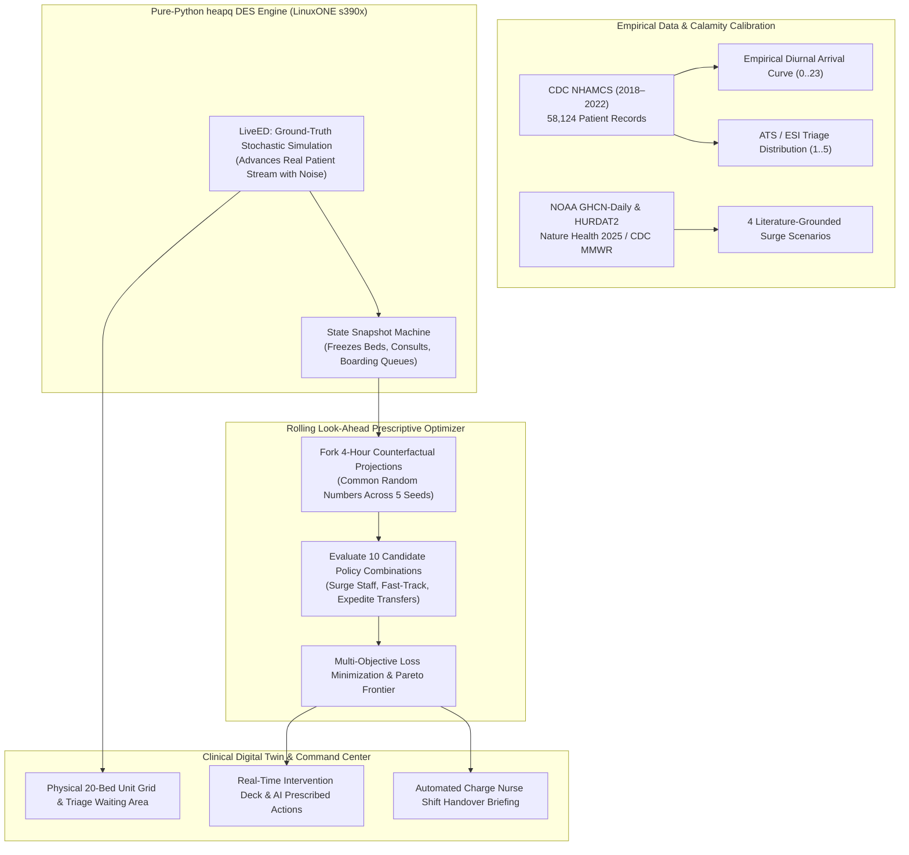

# PulseOps • Emergency Department Surge Simulator & Digital Twin

[](https://ed-surge-simulator.streamlit.app/)
[-052FAD?style=for-the-badge&logo=ibm)](https://www.ibm.com/products/linuxone)
[](https://github.com/Abh-igyan/ed-surge-simulator)
[](LICENSE)

> **IBM Z Datathon 2026 — Track 1: Real-Time AI for Critical Decisions**  
> An autonomous, in-memory Discrete-Event Simulation (DES) digital twin and prescriptive decision-support engine. Models hospital emergency department dynamics during extreme climate calamities (heatwaves, hurricanes, and grid failures) and optimizes tactical resource allocation under strict clinical constraints.

---

## ⚡ Executive Summary

When climate disasters strike—such as extreme heatwaves, hurricane evacuee waves, or regional power grid failures—hospital emergency departments face catastrophic gridlock. 

### The Core Clinical Insight
In mass casualty and extreme surge scenarios, **the primary bottleneck is rarely physician consult speed—it is Inpatient Boarding Block**. 
When inpatient hospital wards upstairs are saturated, admitted patients remain stuck in acute ED beds for hours or days. In a 20-bed ED, as many as 19 beds become blocked by boarders, leaving only 1 bed for intake while dozens of triaged, high-acuity patients back up in the waiting room. 

**Calling extra doctors does almost nothing if there are no beds to examine patients in.**  
**PulseOps** proves this visually and computationally, prescribing Pareto-optimal interventions—such as **Expediting Inpatient Ward Transfers** and **Fast-Track Routing**—that cut wait times by **20+ minutes**, prevent clinical target breaches, and reduce walkouts (LWBS) at minimal operational cost.

---

## 📐 System Architecture

PulseOps is engineered for **IBM LinuxONE (`s390x`)** using **pure Python standard library (`heapq`)** with zero heavy or restricted dependencies (no SimPy, no C extensions).



---

## 🎯 Key Architectural Pillars

### 1. Truth vs. Forecast Separation
- **Live Simulator (`LiveED`)**: Plays out the "True Day" patient stream with stochastic real-world noise.
- **Look-Ahead Optimizer**: Runs rolling 4-hour forward projections using predicted arrivals, evaluating candidate actions **without peeking at the live simulator's stochastic future**.

### 2. Variance Reduction via Common Random Numbers (CRN)
Counterfactual policies (e.g. *Status Quo* vs. *Expedite Ward Transfers* vs. *Surge Physician*) are evaluated against **identical patient arrival streams** across 5 fixed seeds. Differences in outcomes are mathematically attributable to the intervention, not random noise.

### 3. Decoupled Physician vs. Bed Dynamics
- **Triage Nurse**: 2–4 min intake assessment.
- **Physician Consult**: Gamma-distributed face-to-face consult (8–45 min depending on ATS acuity). **Doctors are released immediately after consult**.
- **Bed Hold / Boarding**: Non-admitted patients hold beds for 45 min test turnaround; admitted patients hold ED beds for 120–240 min waiting for upstairs transfer.

### 4. Multi-Objective Clinical Loss Function
$$\text{Loss} = \sum_{k=1}^5 \left(\text{Breaches}_{\text{ATS}_k} \times W_k\right) + \left(5 \times \text{MedianWait}\right) + \left(50 \times \text{LWBS}\right) + \frac{\text{Cost}}{\$10}$$

*Acuity Breach Weights:* ATS 1 (100) | ATS 2 (25) | ATS 3 (10) | ATS 4 (3) | ATS 5 (1).

---

## 🌪️ Literature-Calibrated Disaster Scenarios

PulseOps models 4 distinct operational environments calibrated against historical epidemiological studies:

| Scenario | Clinical Model & Literature Citation | Surge Dynamics | Key Bottleneck |
| :--- | :--- | :--- | :--- |
| **Baseline Monday** | CDC NHAMCS (2018–2022) unweighted empirical distribution | Diurnal curve (~200 visits/24h) | Normal diurnal peak (11:00–16:00) |
| **Extreme Heatwave** | Houston 2011 & Nature Health 2025 (19 states) | +8.9% elderly (65+) surge, +3.6% general volume, elevated cardiac/heat failure | Inpatient bed block (+25% boarding time) |
| **Hurricane Evacuee** | Hurricane Harvey / DFW Hospital Network (55 hospitals) | +11% sustained baseline, +40% afternoon evacuee surge | Outpatient medication refills & trauma |
| **Compound Calamity** | Hurricane Beryl 2024 (Category 1 Storm + 105°F Heat + 2.2M Grid Outage) | +35% volume surge, home oxygen/dialysis device dependency failure | **Acute Inpatient Gridlock** (19/20 beds blocked) |

---

## 🏥 Interactive Digital Twin Features

The Streamlit dashboard (`src/dashboard/app.py`) provides an institutional, clinical-grade interface:

1. **01. System Telemetry**: Live KPI cards for Acute Bed Occupancy %, Mean Door-to-Doctor Wait, ATS 2 Breach Rate, Waiting Room Census, and Inpatient Boarding Block.
2. **02. Tactical Surge Intervention Deck**: Clickable SaaS toggle pills (`st.pills`) for:
   - `Surge Nurse (+1)` ($200)
   - `On-Call Attending (+1)` ($600)
   - `Fast-Track Protocol` ($150)
   - `Expedite Ward Transfers` ($300)
   - `Apply AI Policy` (Instantly applies the Pareto-optimal recommendation)
3. **03. Physical Hospital Floor Plan**:
   - **Waiting Room & Triage**: Nurse intake desks + categorized patient waiting queue with ATS badges (`ATS 1` to `ATS 5`) and breach warnings.
   - **20-Bed Acute Care Unit**: 4×5 visual bay grid showing live statuses (`AVAILABLE`, `IN CONSULT`, `BOARDING BLOCK`, `AWAITING ATTENDING`, `DISCHARGE BUFFER`).
4. **04. Prescriptive AI Decision Support**: Side-by-side counterfactual review comparing *Status Quo* vs. *AI Optimal* vs. *Active Levers*.
5. **05. 24-Hour Patient Flow Trajectory**: Synchronized time-series curves of arrivals, bed occupancy, and waiting queues.
6. **06. Charge Nurse Shift Handover Briefing**: Automated 3-paragraph executive clinical memo generated on the fly.
7. **07. Pareto Frontier Audit**: Complete evaluation table of all 10 candidate policy combinations.

---

## 📂 Project Structure

```text
ed-surge-simulator/
├── configs/
│   └── noaa_heatwave.json            # NOAA Houston heatwave thresholds
├── data/
│   ├── processed/
│   │   └── params.json               # NHAMCS derived hourly & triage distributions
│   └── raw/                          # CDC NHAMCS & NOAA data (gitignored)
├── docs/
│   ├── data_sources.md               # Data provenance and audit documentation
│   └── hurdat2_handoff.md            # NHC hurricane track methodology
├── src/
│   ├── dashboard/
│   │   ├── __init__.py
│   │   └── app.py                    # Streamlit clinical operations digital twin
│   ├── data_processing/
│   │   ├── nhamcs_2018_22.py         # CDC NHAMCS 5-year data processor
│   │   ├── simulation_parameters.py  # Parameter contract export
│   │   ├── noaa_weather.py           # NOAA GHCN weather extractor
│   │   └── disaster_data.py          # FEMA & HURDAT2 disaster linker
│   ├── explainer/
│   │   ├── __init__.py
│   │   └── briefing.py               # Charge nurse shift handover briefing generator
│   ├── optimization/
│   │   ├── __init__.py
│   │   └── optimizer.py              # Rolling look-ahead optimizer & Pareto loss
│   └── simulation/
│       ├── __init__.py
│       ├── ed_simulator.py           # Pure-Python heapq DES engine & snapshot state machine
│       └── scenarios.py              # Calamity scenarios with literature surge factors
├── tests/
│   ├── test_simulator.py             # Engine determinism, CRN, and snapshot tests
│   ├── test_optimizer.py             # Optimizer candidate and Pareto loss tests
│   ├── test_simulation_parameters.py # Parameter schema validation tests
│   └── test_nhamcs_2018_22.py        # Ingestion pipeline tests
├── requirements.txt                  # Minimal dependencies (pandas, streamlit)
├── run.py                            # Unified CLI entrypoint (demo | rolling | dashboard)
└── LICENSE                           # MIT License
```

---

## 🚀 Quickstart & Installation

### 1. Clone & Set Up Environment
```bash
git clone https://github.com/Abh-igyan/ed-surge-simulator.git
cd ed-surge-simulator
```

### 2. Install Dependencies
```bash
pip install -r requirements.txt
```
*(Dependencies: `pandas>=2.2,<3.0`, `streamlit>=1.30.0`)*

### 3. Run the Unit Test Suite
Verify that all 77 unit tests pass:
```bash
python -m unittest discover tests
```
> **Output:** `Ran 77 tests in ~9.9s ... OK`

### 4. Launch the Interactive Digital Twin Dashboard
```bash
python run.py dashboard
```
*(Or directly: `streamlit run src/dashboard/app.py`)*  
Browser will automatically open to `http://localhost:8501`.

### 5. Run Headless CLI Simulation
- **Single-point situation briefing (14:00 peak)**:
  ```bash
  python run.py demo --scenario compound --hour 14
  ```
- **24-hour full rolling optimization cycle**:
  ```bash
  python run.py rolling --scenario compound
  ```

---

## 💻 IBM LinuxONE (`s390x`) Native Compatibility

PulseOps is tailored for mission-critical enterprise environments like **IBM LinuxONE**:
- **Zero Heavy C-Extensions**: Built using Python standard library `heapq`, `math`, `statistics`, and `dataclasses`.
- **Zero Network API Dependencies**: 100% offline, in-memory execution guarantees zero-latency real-time inference during network outages.
- **Deterministic Memory Footprint**: Snapshot state machine clones active patient queues without mutating live states, enabling safe concurrent look-ahead simulations.

---

## 👥 Authors & Team KnightAI

- **Abhigyan Tiwari** — Systems Architecture & AI Engineering ([Portfolio](https://abhigyan-muphy.vercel.app/) • [GitHub](https://github.com/Abh-igyan))
- **Team KnightAI** — IBM Z Datathon 2026

---

## 📄 License

This project is licensed under the [MIT License](LICENSE).
