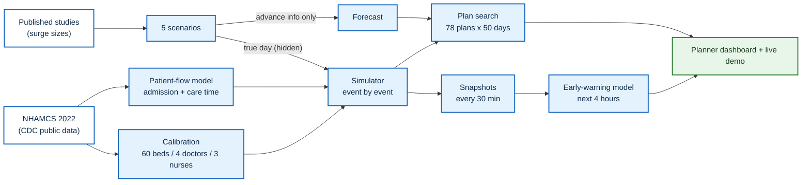

# KnightAI · ED Surge Simulator

**See where an emergency department breaks first in a heatwave or hurricane, and test which fix helps urgent patients most before the surge arrives.**

 -0f62fe>) 

Team **KnightAI** · IBM Z Datathon 2026 · [**Planner dashboard (decision engine)**](https://ed-surge-simulator-final.streamlit.app/?scenario=normal) · [**Hospital-facing product concept**](https://frontend-ten-tan-27na7pqmy1.vercel.app/)


> **This is a simulation, not medical advice.** Patient behaviour comes from national survey data (CDC NHAMCS 2022). Values we
> could not source are labelled as assumptions; see [Honest limits](#honest-limits).

---

## Two products, one idea

KnightAI has two web apps. They have different jobs, so please do not compare their numbers.

|                | [Planner dashboard / decision engine](https://ed-surge-simulator-final.streamlit.app/?scenario=normal)                      | [Hospital-facing product concept / digital twin prototype](https://frontend-ten-tan-27na7pqmy1.vercel.app/)         |
| -------------- | --------------------------------------------------------------------------------------------------------------------------- | ------------------------------------------------------------------------------------------------------------------- |
| **What it is** | The working system: real simulation runs, recommended plans with 95% ranges, early warning, results proven on IBM LinuxONE | What a hospital would buy and use day to day: a digital-twin front end for charge nurses and planners               |
| **Built with** | Python and Streamlit (`src/dashboard/app_v2.py`)                                                                            | React, TypeScript and Vite (`frontend/`), running a TypeScript port of the first simulator version in the browser   |
| **Use it to**  | Check our results and see which fix to try                                                                                  | See how the product could feel in a hospital; it is a prototype, not the source of the results in this README       |

---

## The problem

Heatwaves and hurricanes push 6-13% more patients into emergency departments, often with a day's warning. Charge nurses and
planners have to decide fast: call in an extra doctor? Open fast track? Speed up ward transfers? Guessing wrong wastes money or
leaves urgent patients waiting.

## What KnightAI does

|                               |                                                                                                                                                                                                                      |
| ----------------------------- | -------------------------------------------------------------------------------------------------------------------------------------------------------------------------------------------------------------------- |
| 🏥 **Simulates the day**      | Replays an ED patient by patient (arrival, triage, bed, doctor, discharge or admission) under five scenarios: normal, heatwave, hurricane, hurricane with a sudden burst of critical patients, and a combined surge. |
| 🧪 **Tests the fixes fairly** | Tries 78 plans on the _same_ 50 simulated days and recommends one only when the gain is clear (95% range) and non-urgent patients are not pushed aside. Otherwise it says **"do nothing"**.                          |
| ⏱️ **Warns 4 hours ahead**    | An early-warning model gives the chance of late urgent care, full beds or patients leaving unseen in the next 4 hours, from what a charge nurse can see every 30 minutes.                                            |

---

## Results at a glance

On the reference hospital (60 beds, 4 doctors, 3 triage nurses), 50 simulated days per scenario:

| Scenario             | Patients/day | Urgent seen late | Recommended plan                     | Gain vs "do nothing" (95% range) |
| -------------------- | ------------ | ---------------- | ------------------------------------ | -------------------------------- |
| Normal day           | 200.9        | 13.8%            | **Do nothing**                       | below the 2-point bar            |
| Heatwave             | 219.5        | 26.7%            | +1 clinician 12:00-18:00, fast track | **+12.8** (+8.8 to +16.7)        |
| Hurricane            | 222.7        | 22.3%            | +1 clinician 12:00-18:00             | **+8.5** (+5.1 to +11.9)         |
| Hurricane + burst    | 237.6        | 45.0%            | +1 clinician 12:00-18:00             | **+10.7** (+7.7 to +13.6)        |
| Heatwave + hurricane | 243.2        | 38.9%            | +1 clinician 12:00-18:00, fast track | **+19.7** (+15.8 to +23.5)       |

**Heatwave, on 50 held-out days:** urgent patients seen on time **73% → 87%**, non-urgent median wait **66 → 16 min**, patients
leaving unseen per day **15 → 3**, for about **$1,000 and 6 staff-hours** (illustrative cost).


<sub>Gain = percentage points of urgent patients (triage 1-3) seen on time, after cost and leaving-unseen penalties. Source: `results/scenario_summary.csv`, `results/plan_search/`.</sub>

---

## Built for IBM LinuxONE

The full pipeline runs on **IBM LinuxONE (s390x, big-endian)** and gives the same answers as x86.

|                                    |                                                                      |
| ---------------------------------- | -------------------------------------------------------------------- |
| Full experiment (`run_all.py`)     | **228 s** on 3 cores                                                 |
| Early-warning training data        | **3,750 simulated days / 150,000 snapshots in 11.6 s**               |
| Admission model retrained on s390x | AUC **0.845** (vs 0.732 triage-only)                                 |
| Cross-platform check               | normal, heatwave and hurricane results identical on s390x and x86-64 |

Models are saved as JSON (never pickle), so they load on big-endian hardware. The planner dashboard shows a green
**"Ran on IBM LinuxONE (s390x)"** badge only when the run record `results/linuxone_run.json` says `s390x`.
Step-by-step guide: [`LINUXONE_RUNBOOK.md`](LINUXONE_RUNBOOK.md).

---

## How it works



1. **Real data in.** NHAMCS 2022 (10,125 ED visits from 147 US hospitals) sets arrival patterns, triage mix, admission chance and care time.
2. **Calibrated hospital.** Beds and staff are fitted so a simulated normal day matches the survey's admission rate, leaving-unseen rate and arrival shape.
3. **No cheating.** The planner only sees what is known in advance (scenario and its cited size range), never the true day or the burst hour.
4. **Clear decision rule.** A plan wins only if the low end of its 95% gain range is above 2 points, and non-urgent median waits rise by at most 15%.

### Scenarios

| Scenario          | What happens                                               | Basis                                    |
| ----------------- | ---------------------------------------------------------- | ---------------------------------------- |
| Normal            | Ordinary Monday, ~200 patients                             | NHAMCS 2022 hourly shape and triage mix  |
| Heatwave          | +6% to +13% visits, mostly 12:00-20:00                     | Study of summer-2025 US heatwaves        |
| Hurricane         | +9% to +13% all day at a receiving hospital                | Hurricane Harvey, Dallas-Fort Worth      |
| Hurricane + burst | Hurricane plus 10-20 critical patients in one unknown hour | Stress test                              |
| Compound          | Heatwave and hurricane on the same day                     | Both ranges, effects assumed independent |


### Two models

|            | Patient flow (real data)                  | Early warning (simulated days)                              |
| ---------- | ----------------------------------------- | ----------------------------------------------------------- |
| Predicts   | Admission and care time, at arrival       | Late urgent care, full beds, leaving unseen in the next 4 h |
| Trained on | NHAMCS 2022, whole hospitals held out     | 150,000 snapshots from 750 days per scenario                |
| Result     | Admission AUC **0.845** vs 0.732 baseline | AUC **0.87 / 0.94 / 0.97**                                  |
| Catch rate |                                           | **82-92%** at 5% false alarms (simple rule: 46-79%)         |

Full metrics, splits and features: [`models/model_card.md`](models/model_card.md).

<details>
<summary><b>Calibration: real vs simulated normal day</b></summary>


| Quantity                             | Real (NHAMCS 2022)        | Simulated                 |
| ------------------------------------ | ------------------------- | ------------------------- |
| Urgent (levels 1-3) median wait, min | 15.0                      | 5.1 (known gap)           |
| Left without being seen, %           | 1.89                      | 1.59                      |
| Admitted to hospital, %              | 12.24                     | 11.9                      |
| Peak arrival hour share (10:00), %   | 6.43                      | 6.21                      |
| Median care time, levels 1-5, min    | 332 / 257 / 186 / 91 / 70 | 339 / 250 / 174 / 86 / 76 |

</details>

<details>
<summary><b>Early-warning model in detail</b></summary>


|                               | Urgent late | Beds full | Leaving unseen |
| ----------------------------- | ----------- | --------- | -------------- |
| Test AUC (all scenarios)      | 0.873       | 0.940     | 0.974          |
| Catch rate at 5% false alarms | 82%         | 87%       | 92%            |
| Simple-rule baseline          | 46%         | 61%       | 79%            |

- On normal days it does **not** beat "alarm if the urgent queue is long" for late urgent care (29% vs 31%); it wins on surge days.
- "Leaving unseen" looks easy to predict partly because patience is a fixed 180-minute assumption.
- Split by whole day (450 / 150 / 150), so no day appears in two splits. Saved models are XGBoost JSON.

</details>

---

## Try it

Requires **Python 3.11+** (tested on 3.12).

```bash
git clone https://github.com/naranll/ed-surge-simulator.git
cd ed-surge-simulator
python -m venv .venv
source .venv/bin/activate          # Windows: .\.venv\Scripts\Activate.ps1
pip install -r requirements.txt
pip install numpy scikit-learn xgboost scipy matplotlib
```

**Planner dashboard** (the decision engine, hosted [here](https://ed-surge-simulator-final.streamlit.app/?scenario=normal)):

```bash
pip install -r src/dashboard/requirements.txt
streamlit run src/dashboard/app_v2.py      # open http://localhost:8501/?scenario=heatwave
```

**Live demo in the terminal** (~1 second): what to do in the next 4 hours of a heatwave, from 14:00.

```bash
python run.py demo --scenario heatwave --seed 42 --hour 14
```

**Whole experiment** (~7 minutes on 8 cores): tests, all scenarios, plan search, both models, charts.

```bash
python run_all.py
```

No data download is needed for the demo or dashboard: the simulator uses the committed lookup table in `models/patient_flow/`.

<details>
<summary><b>More commands and options</b></summary>

| Command                                                      | What it does                                                                                               |
| ------------------------------------------------------------ | ---------------------------------------------------------------------------------------------------------- |
| `python run.py demo --scenario <name> --hour <h> --seed <n>` | 4-hour plan from hour `h`; scenarios: `normal`, `heatwave`, `hurricane`, `hurricane_burst`, `compound`     |
| `python run.py rolling --scenario compound --seed 42`        | Walks the live demo through the whole day (~1 min)                                                         |
| `python run_all.py --quick`                                  | Small check run (2-4 min). **Overwrites `results/` with small results**; rerun the full command afterwards |
| `python run_all.py --workers N --replications N`             | Parallel workers; plan-search runs per plan                                                                |
| `python -m pytest -q tests event_nhamcs`                     | Test suite (~2-3 min)                                                                                      |

Extra options: `--replications N` and `--workers N` on `run.py demo`; `--all-tests` on `run_all.py`;
`ED_USE_LEGACY_PARAMS=1` restores the original placeholder settings.

**Rebuilding the NHAMCS data** (optional, never committed): download the 2022 ED Stata file from
[CDC NCHS](https://www.cdc.gov/nchs/nhamcs/documentation/index.html), save it as `data/raw/nhamcs/ed2022-stata.zip`, then run
`python src/data_processing/nhamcs_preprocessing.py`. See [`src/data_processing/README.md`](src/data_processing/README.md).

**Deploying the dashboard:** [`src/dashboard/DEPLOY.md`](src/dashboard/DEPLOY.md). The hosted planner dashboard is deployed from the maintainer's personal deployment repo (git remote `deploy`, [github.com/naranll/ed-surge-simulator](https://github.com/naranll/ed-surge-simulator)), so it may lag behind this repo until it is synced.

</details>

---

## Honest limits

- The early-warning model learns the **simulator**, not a real hospital. It has not been validated on real ED data.
- On a normal day, simulated urgent median wait is **5.1 min** vs **15.0 min** in the survey. We report this gap rather than hide it.
- NHAMCS is a national sample (~40% response rate): triage is missing for 25.9% of visits, and there are only 139 level-1 visits.
- Care time is "length of visit minus wait", a proxy that includes tests and boarding.
- Costs ($150 per clinician-hour, etc.) are **illustrative**, not sourced.

<details>
<summary><b>Full list of data sources and assumptions</b></summary>

**Data used**

| Dataset                                    | Used for                                                                                                |
| ------------------------------------------ | ------------------------------------------------------------------------------------------------------- |
| NHAMCS 2022 ED file (CDC)                  | The only patient data: arrivals, triage mix, admission, care time, calibration targets (PATWT-weighted) |
| Published studies                          | Surge sizes only (heatwave +6-13%, hurricane +9-13%), as cited by the team                              |
| NOAA, FEMA, hurricane tracks               | Background context only                                                                                 |
| CMS Timely and Effective Care, MIMIC-IV-ED | Not used; future validation                                                                             |

**Cited, not independently checked:** surge ranges; Australasian Triage Scale time targets (immediate, 10, 30, 60, 120 min) mapped to triage levels 1-5.

**Fitted by calibration:** 60 beds, 4 doctors, 3 triage nurses (NHAMCS has no staffing counts).

**Our assumptions (unsourced):**

- 200 patients/day; Small / Medium presets at 30% / 60%; "not saturated" = peak beds under 95%
- Doctor consult means 45 / 30 / 20 / 12 / 8 min by level; triage 2-4 min; patience 180 min
- Fast track cuts doctor time 40% for levels 4-5; faster ward transfers 25% / 50%
- Heatwave window 12:00-20:00; burst of 10-20 patients between 12:00 and 21:00, 25% level 1; compound effects multiply
- Scoring: 7 points per $1000, 0.5 points per patient leaving unseen, fairness limit 15% + 1 min, 2-point bar, 6-hour plan windows every 3 hours
- Rule (c): on a worse-than-normal day "do nothing" is not allowed if any plan's 95% range stays above 0; otherwise the output names the constraint (boarding, beds or staff)
- Early-warning breaches: at least 2 late urgent patients and 25% late (10-min grace for level 1); beds above 95%; at least 1 leaving unseen

</details>

---

## Repo layout

```
run.py / run_all.py      CLI demo and one-command experiment
configs/capacity.json    calibrated hospital size
src/simulation/          simulator, scenario registry, forecaster
src/optimization/        plan search
src/demo/                live 4-hour demo
src/dashboard/           app_v2.py (planner dashboard), app.py (classic)
src/data_processing/     NHAMCS, NOAA, FEMA, HURDAT2 preprocessing
models/                  model card, saved JSON models, patient-flow lookup
results/                 run outputs and LinuxONE run record
frontend/                React + TypeScript hospital-facing product concept (digital twin prototype)
tests/                   simulator, scenario, optimiser, model and data tests
docs/                    data provenance and README images
```

## Tech stack

**Simulator, scenarios and plan search:** pure Python standard library · **Models:** scikit-learn, XGBoost · **Charts:** matplotlib ·
**Planner dashboard:** Streamlit · **Product concept:** React, TypeScript, Vite · **Platform:** IBM LinuxONE (s390x)

## Team KnightAI

- **Abhigyan Tiwari**: simulator, first optimiser, dashboards, web front end ([GitHub](https://github.com/Abh-igyan))
- **Ken**: data preprocessing, LinuxONE testing, video and pitch
- **Narandelgerekh**: scenario registry, ML pipeline, LinuxONE deployment and final runs, dashboard redesign ([GitHub](https://github.com/naranll))

## License

MIT. See [LICENSE](LICENSE).
