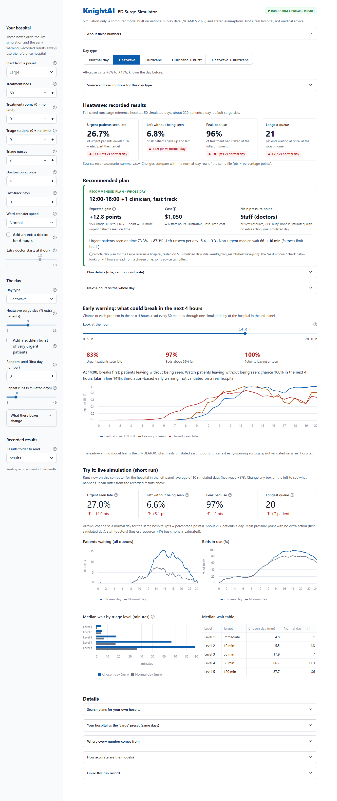
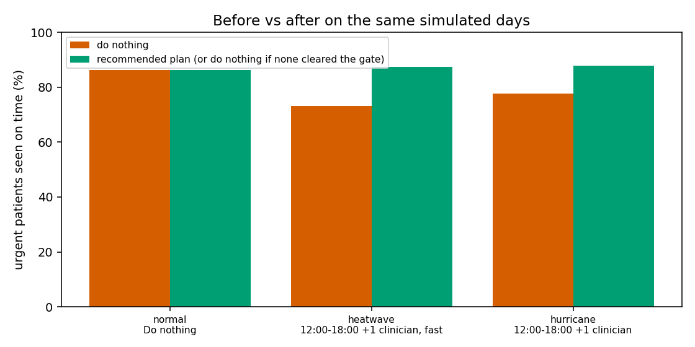
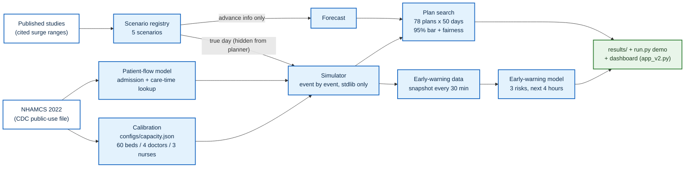
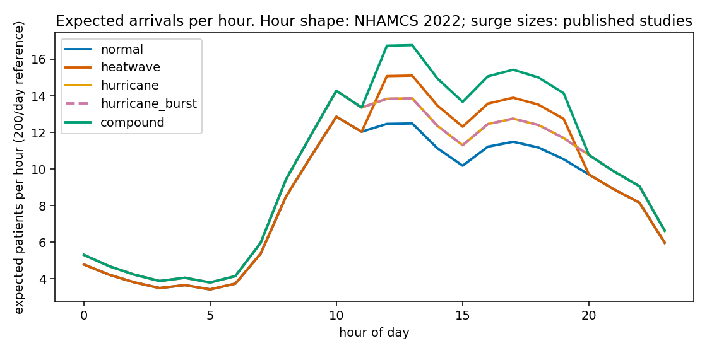
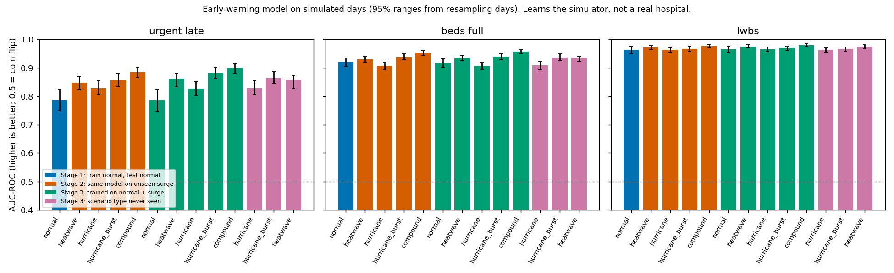
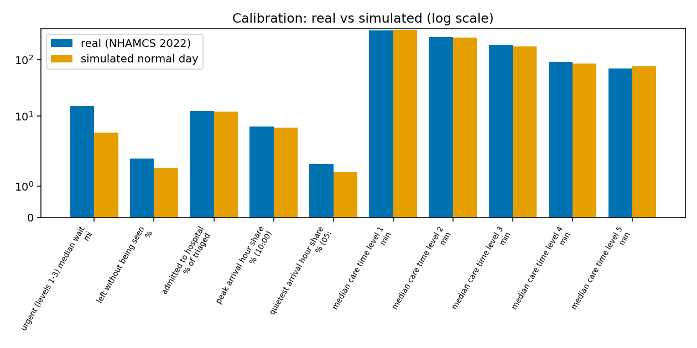

# KnightAI - ED Surge Simulator

**Team KnightAI** · IBM Z Datathon 2026

A simulator of a hospital emergency department (ED) that shows where it breaks first in a heatwave or hurricane surge, and tests which fix helps urgent patients most.

> **This is a simulation.** It is not a real hospital and not medical advice. Patient behaviour comes from national survey
> data (NHAMCS 2022); many settings are stated assumptions (listed in [Assumptions](#assumptions-and-unsourced-values)).

Live demo (Streamlit, deployed from a separate repo that is **not synced** with this one): https://ed-surge-simulator.streamlit.app/

---

## What it does

- **Runs a day in the ED, event by event.** It can run a normal day, a heatwave, a hurricane, a hurricane with a sudden burst of
  very urgent patients, or a combined surge. It reports waits by triage level, patients who leave unseen, bed use and queues.
- **Tests fixes on the same simulated days.** The fixes are an extra doctor for 6 hours, fast track and faster ward transfers. It
  recommends a plan only when the gain is clear (95% range) and non-urgent patients do not wait unfairly longer. Otherwise it says
  "do nothing".
- **Warns about the next 4 hours.** An early-warning model gives the chance of late urgent care, full beds or patients leaving
  unseen. It learns from simulated days, not from a real hospital.



_The planner dashboard (`src/dashboard/app_v2.py`) on a simulated heatwave day, reading the final LinuxONE run in `results/`._



_Share of urgent patients (triage 1-3) seen on time, "do nothing" vs the recommended plan, on the same 50 simulated days
(reference hospital). Source: `results/demo_results.json`._

---

## Quick start (about 10 minutes)

You need **Python 3.11 or newer** (tested with 3.12) and git.

### 1. Get the code and install

**PowerShell (Windows)**

```powershell
git clone https://github.com/naranll/ed-surge-simulator.git ed-surge-simulator
cd ed-surge-simulator
py -3.12 -m venv .venv
.\.venv\Scripts\Activate.ps1
python -m pip install -r requirements.txt
python -m pip install numpy scikit-learn xgboost scipy matplotlib     # models and charts
```

**bash (Linux / macOS)**

```bash
git clone https://github.com/naranll/ed-surge-simulator.git ed-surge-simulator
cd ed-surge-simulator
python3 -m venv .venv
source .venv/bin/activate
python -m pip install -r requirements.txt
python -m pip install numpy scikit-learn xgboost scipy matplotlib     # models and charts
```

The simulator, scenarios, plan search and live demo use only the Python standard library. The extra packages are needed for
the two models, the charts and the tests.

### 2. The data file (optional, never committed)

The code expects the cleaned NHAMCS 2022 file at:

```
data/processed/nhamcs_2022_cleaned.csv
```

NHAMCS 2022 is a public CDC download
([NCHS NHAMCS documentation and datasets](https://www.cdc.gov/nchs/nhamcs/documentation/index.html)). The data is never committed.
To build the cleaned file, put the official Stata archive at `data/raw/nhamcs/ed2022-stata.zip` and run:

```bash
python src/data_processing/nhamcs_preprocessing.py
# or: python src/data_processing/nhamcs_preprocessing.py --input data/raw/nhamcs/ed2022-stata.zip
```

This writes `data/processed/nhamcs_2022_cleaned.csv`, `data/processed/nhamcs_2022_triage_distribution.csv` and a report under
`reports/`. More detail: [`src/data_processing/README.md`](src/data_processing/README.md) and [`docs/data_sources.md`](docs/data_sources.md).

**Without the data file the run still works.** The patient-flow model and the calibration step are skipped with a clear message,
and the simulator uses the committed lookup table `models/patient_flow/admission_lookup.json`. It holds totals only, no patient rows.

### 3. Live demo: one scenario, next 4 hours (about 1 second)

```bash
python run.py demo --scenario heatwave --seed 42 --hour 14
```

Run all five scenarios:

```bash
# bash
for s in normal heatwave hurricane hurricane_burst compound; do python run.py demo --scenario $s --seed 42 --hour 14; done
```

```powershell
# PowerShell
foreach ($s in "normal","heatwave","hurricane","hurricane_burst","compound") { python run.py demo --scenario $s --seed 42 --hour 14 }
```

| Flag               | Meaning                                                                                           |
| ------------------ | ------------------------------------------------------------------------------------------------- |
| `--scenario`       | `normal`, `heatwave`, `hurricane`, `hurricane_burst` or `compound`                                |
| `--hour`           | hour of the day at which the demo stops and looks ahead                                           |
| `--seed`           | which simulated day (same seed means the same day)                                                |
| `--replications N` | forecast runs per plan (default 30)                                                               |
| `--workers N`      | worker processes for the forecast runs (1 = serial; helps the plan search, barely helps the demo) |

`python run.py rolling --scenario compound --seed 42` walks the live demo through the whole day (about 1 minute).
`ED_USE_LEGACY_PARAMS=1` restores the original placeholder numbers and the original `run.py` behaviour exactly.

### 4. The whole experiment in one command

```bash
python run_all.py --quick      # check: 2 scenarios, small run, about 2-4 minutes
python run_all.py              # full: 5 scenarios x 50 days, plan search, both models (about 7 minutes on an 8-core PC)
```

Options: `--workers N`, `--replications N` (plan-search runs per plan: 30 in `--quick`, 50 in full), `--all-tests` (also run
the data-pipeline tests, which need downloaded raw data).

> **Warning:** `run_all.py` rewrites `models/` and `results/`. A `--quick` run **replaces the full-size results with small ones**.
> Run the full command again afterwards before you use the results.

Each run writes `results/run.log` and a run record: `results/linuxone_run.json` only if the machine reports `s390x`,
otherwise `results/local_run.json`. Steps: tests, scenarios and plan search, early-warning data (with a 1/2/4/8-worker timing
table), calibration, patient-flow model, early-warning model, demo results, charts. A failed step is recorded and the run continues.

### 5. Dashboard (the one we demo)

The planner dashboard is `src/dashboard/app_v2.py` (Streamlit, laptop only).

```bash
python -m pip install -r src/dashboard/requirements.txt
streamlit run src/dashboard/app_v2.py
```

Then open **http://localhost:8501** (add `?scenario=heatwave` to open a day type directly). It reads `results/` and `models/`,
which hold the final LinuxONE run. Run it from the repo root so the light theme in `.streamlit/config.toml` is used.

The green "Ran on IBM LinuxONE (s390x)" pill appears only when `results/linuxone_run.json` says `s390x`.
Deploying it to Streamlit Community Cloud: [`src/dashboard/DEPLOY.md`](src/dashboard/DEPLOY.md).

### 6. Tests

```bash
python -m pytest -q tests event_nhamcs
```

About 2-3 minutes (251 passed on a Windows PC with the data file in place). Some data-pipeline tests need pandas and downloaded data.

---

## How it works



| Part                          | What it does                                                                                                                                         | Where                                                      |
| ----------------------------- | ---------------------------------------------------------------------------------------------------------------------------------------------------- | ---------------------------------------------------------- |
| Simulator                     | Event-by-event model: arrival, triage, bed, doctor, then discharge or admission. Plain Python, no extra libraries.                                   | `src/simulation/ed_simulator.py`                           |
| Scenario registry             | ONE definition of all five scenarios, used by every entry point.                                                                                     | `src/simulation/registry.py`                               |
| Capacity file                 | ONE source of the hospital size (beds, doctors, triage nurses), fitted by calibration.                                                               | `configs/capacity.json`                                    |
| Patient-flow model (model 1)  | Learns from real NHAMCS visits how likely a patient is to be admitted and how long care takes. The simulator uses a small lookup table made from it. | `scripts/train_patient_flow.py`, `models/patient_flow/`    |
| Early-warning model (model 2) | Learns from thousands of simulated days the chance, in the next 4 hours, of late urgent care, full beds, or patients leaving unseen.                 | `scripts/train_early_warning.py`, `models/predict_risk.py` |
| Plan search (whole day)       | Tests an extra doctor for 6 hours, fast track and faster ward transfers at different start times on the same random days.                            | `src/optimization/optimizer.py`                            |
| Live demo (next 4 hours)      | Same rules as the plan search, applied to the next 4 hours of a live day.                                                                            | `run.py`, `src/demo/live_demo.py`                          |
| Dashboard                     | A what-if page for a hospital planner (laptop only).                                                                                                 | `src/dashboard/app_v2.py`                                  |
| One-command run               | Tests, scenarios and plan search, both models, timing.                                                                                               | `run_all.py`                                               |

### Scenarios

| Key               | What it is                                                         | Source                                                                                     |
| ----------------- | ------------------------------------------------------------------ | ------------------------------------------------------------------------------------------ |
| `normal`          | Ordinary Monday                                                    | Hourly shape and triage mix: NHAMCS 2022. Volume 200/day: UNSOURCED                        |
| `heatwave`        | +6% to +13% visits, extra visits 12:00-20:00, known the day before | Size: Nature Health study of summer-2025 US heatwaves (team-cited). Window: UNSOURCED      |
| `hurricane`       | +9% to +13% all day at a receiving hospital, known the day before  | Hurricane Harvey, Dallas-Fort Worth receiving hospital (team-cited)                        |
| `hurricane_burst` | Hurricane plus 10-20 very urgent patients in one unknown hour      | Burst: UNSOURCED stress test                                                               |
| `compound`        | Heatwave and hurricane on the same day                             | Both cited ranges. **ASSUMPTION: effects multiply (independence).** Not a historical event |

The planner only sees what is known in advance (the scenario and its cited size range). It never sees the true day, its sampled
size or the burst hour.



### How a plan is chosen (same rules everywhere)

- **Score** = % of urgent patients (triage levels 1-3) seen within their time target, minus 7 points per $1000 of cost, minus 0.5 points per patient who leaves unseen.
- **Fairness**: the median wait of non-urgent patients may rise by at most 15% (+1 minute).
- **Bar**: a plan is recommended only if the low end of the 95% range of its gain over "do nothing" is above 2 points.
- **Rule (c)**: when urgent patients are seen late more often than on a normal day, "do nothing" is not allowed while some tested plan's 95% range stays above 0.
  If none does, the output says "No tested plan helps; constraint is <boarding / beds / staff>".
- `run.py demo` applies these rules to the **next 4 hours** and always also prints the **whole-day plan** for the scenario, with one sentence if they differ (a busy afternoon can justify an extra doctor even when the whole day does not).
- Every plan shows its cost in dollars and in staff-hours. **Costs are UNSOURCED and illustrative.**

---

## Models

### Model 1: patient flow (real data, NHAMCS 2022)

|                                  | Admission                                                                                                                                                 | Care time                                                                                            |
| -------------------------------- | --------------------------------------------------------------------------------------------------------------------------------------------------------- | ---------------------------------------------------------------------------------------------------- |
| Target                           | Admitted to this hospital (`ADMITHOS` = 1)                                                                                                                | log of care time = `LOV - WAITTIME` (a **proxy**: includes tests and boarding, not pure doctor time) |
| Features (known at arrival only) | age, triage level, arrival hour, weekday, payment type, sex, ambulance arrival, injury flag                                                               | same                                                                                                 |
| Never used                       | waits, length of visit, disposition, boarding, diagnoses, tests, vital signs, anything recorded after arrival                                             | same                                                                                                 |
| Rows                             | 10,125 visits with valid triage 1-5 (of 16,025), PATWT-weighted, 147 hospitals                                                                            | 8,547 with a valid care time                                                                         |
| Split                            | Whole hospitals held out: 80% train / 20% test (117 / 30 hospitals), seed 20261017; 5-fold hospital-grouped CV; "simplest within one standard error" rule | same                                                                                                 |
| Chosen algorithm                 | HistGradientBoosting (20 settings searched)                                                                                                               | HistGradientBoosting (20 settings searched)                                                          |
| Test result (held-out hospitals) | **AUC 0.845 (95% 0.790-0.878)**                                                                                                                           | MAE (log) **0.676**, R-squared 0.19                                                                  |
| Baseline                         | Triage level only: AUC **0.732** (95% 0.651-0.788)                                                                                                        | Median by triage level: MAE (log) 0.694                                                              |
| Other                            | Brier 0.081 vs 0.090; calibration error (ECE) 0.025                                                                                                       |                                                                                                      |

Admission is only modestly predictable at the door: age adds information on top of triage level, but much is unknown at arrival.
HistGradientBoosting cannot be saved portably, so the best portable candidate (XGBoost JSON) is saved as well. **The simulator
reads neither saved model.** It reads only the lookup table `models/patient_flow/admission_lookup.json` (triage level x age band,
small cells blended toward the triage-level rate). Details: [`models/model_card.md`](models/model_card.md).

### Model 2: early warning (simulated days)

**This model learns the SIMULATOR, which rests on stated assumptions. It is a fast early-warning surrogate, not validated on a real hospital.**

|                                              | Urgent late                                                                                                                                                                     | Beds full               | Leaving unseen                   |
| -------------------------------------------- | ------------------------------------------------------------------------------------------------------------------------------------------------------------------------------- | ----------------------- | -------------------------------- |
| Target (next 4 hours, under "do nothing")    | at least 2 late urgent patients and at least 25% of urgent patients late (level 1 gets a 10-min grace)                                                                          | bed occupancy above 95% | at least 1 patient leaves unseen |
| Features                                     | what a charge nurse could see every 30 min: queues, longest waits, bed use, staff on shift, hour, patients the forecast expects                                                 | same                    | same                             |
| Data                                         | 750 day numbers per scenario type, 150,000 snapshots; hospital size cycles Small / Medium / Large                                                                               | same                    | same                             |
| Split                                        | by whole day number: 450 train / 150 validation / 150 test days; a day number is never in two splits                                                                            | same                    | same                             |
| Algorithm                                    | chosen among portable models (logistic regression or XGBoost; HistGradientBoosting tried too) by day-grouped CV; the saved models in `models/early_warning/` are XGBoost (JSON) | same                    | same                             |
| Test AUC (all scenarios)                     | **0.873**                                                                                                                                                                       | **0.940**               | **0.974**                        |
| Catch rate at 5% false alarms on normal days | 82%                                                                                                                                                                             | 87%                     | 92%                              |
| Simple-rule baseline (same alarm line)       | 46%                                                                                                                                                                             | 61%                     | 79%                              |

Read the numbers with care:

- On **normal days** the model does **not** beat the simple rule "alarm if the urgent queue is long" for urgent late
  (catches 29% vs 31%). It does better on surge days.
- On surge days it never saw, the model's AUC was **not** worse (0.853 vs 0.785 for urgent late). It misses more risky
  moments at the alarm line set on normal days, and retraining with surge days raises that catch rate.
- "Leaving unseen" looks very predictable mainly because patience is a fixed 180-minute ASSUMPTION: anyone already waiting about
  150 minutes will leave.



_AUC by training stage and scenario, with 95% ranges from resampling days. Source: `models/stage_results.csv`._

### Calibration: real vs simulated normal day



| Quantity                                        | Real (NHAMCS 2022)        | Simulated normal day      |
| ----------------------------------------------- | ------------------------- | ------------------------- |
| Urgent (levels 1-3) median wait, min            | 15.0                      | **5.1** (gap, see Limits) |
| Left without being seen, %                      | 1.89                      | 1.59                      |
| Admitted to hospital, % of triaged visits       | 12.24                     | 11.9                      |
| Peak arrival hour share (10:00), %              | 6.43                      | 6.21                      |
| Quietest arrival hour share (05:00), %          | 1.71                      | 1.47                      |
| Median care time, levels 1 / 2 / 3 / 4 / 5, min | 332 / 257 / 186 / 91 / 70 | 339 / 250 / 174 / 86 / 76 |

Chosen capacity (ASSUMPTION set by calibration): 60 beds, 4 doctors, 3 triage nurses; 30 simulated days. Source: `results/calibration.csv`.

---

## Results

### Five scenarios (reference hospital, 50 simulated days each)

| Scenario        | Patients/day | Urgent late % | Left unseen % | Peak beds % | Recommended plan                     | Gain vs "do nothing" (95% range)                |
| --------------- | ------------ | ------------- | ------------- | ----------- | ------------------------------------ | ----------------------------------------------- |
| normal          | 200.9        | 13.75         | 1.89          | 87.1        | Do nothing                           | best plan +0.26 to +1.90, below the 2-point bar |
| heatwave        | 219.5        | 26.73         | 6.78          | 96.0        | 12:00-18:00 +1 clinician, fast track | +12.77 (+8.82 to +16.71)                        |
| hurricane       | 222.7        | 22.31         | 5.25          | 94.9        | 12:00-18:00 +1 clinician             | +8.49 (+5.08 to +11.91)                         |
| hurricane_burst | 237.6        | 45.04         | 11.09         | 99.1        | 12:00-18:00 +1 clinician             | +10.67 (+7.72 to +13.62)                        |
| compound        | 243.2        | 38.92         | 11.76         | 99.1        | 12:00-18:00 +1 clinician, fast track | +19.67 (+15.81 to +23.52)                       |

Each plan search tested 78 plans on 50 look-ahead days, then checked the pick on 50 separate truth days. Gains are in points
(1 point = 1 percentage point of urgent patients seen on time, after the cost and leaving-unseen penalties). Recommended plans cost
$900-$1,050 for 6 staff-hours (UNSOURCED, illustrative). Sources: `results/scenario_summary.csv`, `results/plan_search/*.txt`.

On the 50 truth days, heatwave: urgent seen on time 73.3% -> 87.3%, non-urgent median wait 65.8 -> 15.7 min, leaving unseen
15.4 -> 3.3. Hurricane: 77.7% -> 87.9%, 51.3 -> 15.6 min, 12.1 -> 2.9.

### IBM LinuxONE run

| Item                                 | Value                                                                                                                                                         |
| ------------------------------------ | ------------------------------------------------------------------------------------------------------------------------------------------------------------- |
| Machine                              | IBM LinuxONE, `uname -m` = **s390x** (big-endian), 3 cores                                                                                                    |
| Full run (`run_all.py`)              | **228 s** total                                                                                                                                               |
| Early-warning data                   | **3,750 simulated days / 150,000 snapshots in 11.6 s**                                                                                                        |
| Admission model (retrained on s390x) | AUC 0.845 vs 0.732 triage-only                                                                                                                                |
| Same answers as x86                  | the normal, heatwave and hurricane rows (urgent late, leaving unseen, peak beds, recommended plan) are identical on s390x and on the Windows x86-64 run above |

Say "ran on LinuxONE" only about what the s390x run record `results/linuxone_run.json` records. The dashboard and every display
check that it says `s390x`. The 5-scenario table above comes from the Windows x86-64 run in `results/`.

### Run it on LinuxONE

Only **one person** may use the team's LinuxONE account at a time. Full step-by-step guide with screenshots checklist:
[`LINUXONE_RUNBOOK.md`](LINUXONE_RUNBOOK.md).

Target container: Python 3.12, numpy 2.0.2, pandas 3.0.6, scikit-learn 1.9.0, xgboost 3.4.1, scipy 1.13.1, matplotlib 3.11.2.
No pyarrow and no Streamlit; the pipeline needs neither. The dashboard runs on a laptop and reads the results.

1. Start the organisers' Jupyter Lab container on port 38888 with a shared folder mounted. **The image name and the
   container port are placeholders: take them from the organisers' guide.**
   ```bash
   mkdir -p ~/shared
   docker run -d --name jupyter-lab -p 38888:<container-port> \
     -v ~/shared:/home/ibm-user/shared \
     <organisers-jupyter-lab-image>
   ```
   Open a terminal in Jupyter Lab, then check the machine: `uname -m` must print `s390x`. Also run `nproc` and `lscpu`.
2. Get the code into the shared folder and install pytest (it may be missing):
   ```bash
   cd /home/ibm-user/shared
   git clone https://github.com/naranll/ed-surge-simulator.git ed-surge-simulator      # later: cd ed-surge-simulator && git pull
   cd ed-surge-simulator
   python -m pip install pytest
   python -c "import numpy, pandas, sklearn, xgboost, scipy, matplotlib; print(numpy.__version__, pandas.__version__)"
   ```
3. Copy the cleaned data file from your PC (it is not in git) to `data/processed/nhamcs_2022_cleaned.csv`, for example into
   `~/shared/ed-surge-simulator/data/processed/` on the host. Check both ends match with `sha256sum` (PowerShell: `Get-FileHash -Algorithm SHA256 <file>`).
4. Run inside `tmux` so it survives a dropped connection:
   ```bash
   tmux new -s edrun
   python run_all.py --quick --workers 3 2>&1 | tee quick_run.out    # check first
   python run_all.py --workers 3 2>&1 | tee full_run.out             # full run
   for s in normal heatwave hurricane hurricane_burst compound; do python run.py demo --scenario $s --seed 42; done | tee demo.out
   ```
   Each step should end `ok`, then `Wrote results/linuxone_run.json`. If it says `local_run.json`, the machine was not s390x.
   Detach with `Ctrl-b` then `d`; come back with `tmux attach -t edrun`.
5. Look at the record: `cat results/linuxone_run.json` (machine, cores, seconds per step, worker timings). The results are in
   `~/shared/ed-surge-simulator/results` on the host; copy them home with `scp -r`.

On s390x one test (exact text hashes of generated arrivals) is skipped on purpose: the last digit of some maths results can differ
on that CPU; a separate test still checks the arrivals exactly. Models are saved as JSON, so they load on big-endian s390x.
Never copy pickle files between machines.

---

## Data used

| Dataset                                                         | Used by code?                                   | For what                                                                                                                                                                                                                                  |
| --------------------------------------------------------------- | ----------------------------------------------- | ----------------------------------------------------------------------------------------------------------------------------------------------------------------------------------------------------------------------------------------- |
| **NHAMCS 2022 emergency department file** (CDC public-use file) | **Yes. The only patient dataset read by code.** | Arrivals by hour, weekday shares, triage mix, admission by triage level and age, care time, calibration targets (urgent median wait, share leaving unseen). Weighted by the survey weight PATWT. Not in the repo; anyone can download it. |
| Published studies                                               | Yes, as cited numbers                           | Surge sizes only: heatwave +6% to +13% of visits; hurricane (receiving hospital) +9% to +13%. As cited by the team, not independently checked.                                                                                            |
| NOAA weather, FEMA declarations, NOAA hurricane tracks          | Context only                                    | Background for the story. They never set a surge size and are never joined to patient records.                                                                                                                                            |
| CMS Timely and Effective Care, MIMIC-IV-ED                      | **No**                                          | Not used. Future work: a check against a real hospital's timings.                                                                                                                                                                         |

## Assumptions and UNSOURCED values

**From data (NHAMCS 2022, computed in code):** arrivals by hour, weekday shares, triage mix, admission chance by triage level and age band,
care time by triage level (admitted / discharged), urgent median wait 15 min and 1.9% leaving unseen (calibration targets).

**Cited, not independently checked:** heatwave +6% to +13%, hurricane +9% to +13%; time targets from the Australasian Triage Scale
(immediate, 10, 30, 60, 120 min), applied to NHAMCS triage levels 1-5 as an assumption.

**Fitted, not measured:** the reference hospital (60 beds, 4 doctors, 3 triage nurses) is chosen so the simulated normal day matches the NHAMCS targets. NHAMCS has no bed or staff counts.

**UNSOURCED (our choices):**

- volume 200 patients per day; Small / Medium presets at 30% / 60% of it (not calibrated); calibration search grid; "not saturated" = peak beds under 95%;
- doctor consult time (means 45 / 30 / 20 / 12 / 8 min by level), triage time 2-4 min, fixed patience of 180 min before leaving unseen;
- fast-track effect (-40% doctor time for levels 4-5) and faster ward transfers (25% / 50%);
- minimum bed hold 5 min after the consult; care time capped at 24 h; small-cell shrinkage k = 10 in the admission table;
- heatwave window 12:00-20:00; burst size 10-20, hour 12:00-21:00, 25% level 1; compound effects multiply;
- all costs ($150 per clinician-hour, $150 per fast-track window, $300 per 30-point transfer cut), cost penalty 7 points per $1000, 0.5 points per patient leaving unseen,
  fairness limit 15% + 1 min, 2-point bar, 6-hour plan windows starting every 3 hours, 4-hour demo window;
- rule (c) helpers: boarding is "the constraint" when admitted patients waiting for a ward hold 25% or more of beds, a resource busy 90% or more is "saturated", up to 3 plans re-checked;
- early-warning breach definitions (at least 2 late urgent patients and 25% late; level-1 grace 10 min; beds above 95%; at least 1 leaving unseen) and the 5% false-alarm line.

## Limits (read these)

- The early-warning model learns the **simulator**, which rests on the assumptions above; it is not validated on a real hospital.
- Only the reference (Large) hospital is calibrated. On a normal day the simulated median wait for urgent patients is **5.1 minutes**; the survey reports **15.0 minutes**. We report this gap and have not closed it.
- Triage level is missing in **25.9%** of 2022 visits and wait time in **17.2%**; there are only **139** level-1 visits. National sample (response rate about 40%), not one hospital.
- Care time is "leave time minus wait time" from the survey: a proxy that includes tests and, for admitted patients, boarding. It is not pure doctor time.
- The "leaving unseen" warning looks very accurate partly because everyone has the same assumed patience of 180 minutes.
- On normal days the early-warning model does **not** beat a simple rule ("alarm if the urgent queue is long") for late urgent care. It does better on surge days.
- The live demo's 4-hour view and the whole-day plan can differ on purpose; both are printed.
- Not done yet: boarding times, patience and the heatwave shift toward older patients are not yet taken from the data.

---

## Repo layout

```
run.py                      CLI: demo | rolling | dashboard
run_all.py                  one command: tests, scenarios + plan search, models, timing
configs/capacity.json       calibrated hospital size
src/simulation/             simulator, scenario registry, scenarios, forecaster, hospital presets, patient flow
src/optimization/           plan search (optimizer.py)
src/demo/                   live demo (next 4 hours)
src/explainer/              rule-based shift briefing (no language model)
src/dashboard/              app_v2.py (planner dashboard), app.py (classic dashboard)
src/data_processing/        NHAMCS, NOAA, FEMA, HURDAT2 preprocessing
scripts/                    calibration, model training, day generation, charts
models/                     model card, metrics, saved models (JSON), patient-flow lookup
results/                    run outputs (scenario_summary.csv, plan_search/, for_slides/, run records)
tests/                      simulator, scenario, optimiser, model and data tests
event_nhamcs/               standalone NHAMCS 2018-22 exporter (cross-check only)
docs/                       data provenance; docs/images/ holds the README charts
LINUXONE_RUNBOOK.md         step-by-step LinuxONE guide
```

### Other parts in this repo

| Part                                         | What it is                                                                                                                                                                                                                                 | Where                  | How to run                                                        |
| -------------------------------------------- | ------------------------------------------------------------------------------------------------------------------------------------------------------------------------------------------------------------------------------------------ | ---------------------- | ----------------------------------------------------------------- |
| Classic dashboard                            | The first Streamlit digital-twin page: 20-bed floor plan, waiting room, intervention toggles, 24-hour charts, shift briefing. Uses the original placeholder simulator settings, not the calibrated capacity or the plan-search rulebook.   | `src/dashboard/app.py` | `python run.py dashboard` or `streamlit run src/dashboard/app.py` |
| Web front end                                | A React + TypeScript + Vite page. It does not call the Python code.                                                                                                                                                                        | `frontend/`            | `cd frontend && npm install && npm run dev`                       |
| NHAMCS 2018-22 export with LinuxONE evidence | A standalone, standard-library exporter of arrival-hour and triage shares from the third-party NHAMCS 2018-22 file, with an execution record from an s390x machine (2026-10-17). The simulator does not read it; it is a cross-check only. | `event_nhamcs/`        | See `event_nhamcs/README.md`                                      |

## Tech stack

Python 3.11+. The simulator, scenarios, registry, forecast, plan search and live demo use only the standard library.
Models and charts: numpy, pandas, scikit-learn, XGBoost, scipy, matplotlib. Dashboard: Streamlit (laptop only). Tests: pytest.
Models are saved as JSON so they load on any machine, including big-endian s390x.

## Team

Team **KnightAI**, IBM Z Datathon 2026.

- **Abhigyan Tiwari**: simulator, first optimiser, dashboards, web front end ([GitHub](https://github.com/Abh-igyan))
- **Ken**: data preprocessing, linux one tester, video maker, pitch manager(`src/data_processing/`, `docs/`)
- **Narandelgerekh**: scenario registry, early-warning and patient-flow ML pipeline, LinuxONE (s390x) deployment and final runs, dashboard redesign, README ([GitHub](https://github.com/naranll))

## License

MIT. See [LICENSE](LICENSE).
